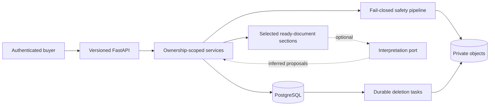

# Viesett architecture

A modular monolith: FastAPI and Pydantic v2 at the boundary, explicit application services, async SQLAlchemy 2, PostgreSQL as authoritative persistence, Alembic migrations, provider-neutral private storage and interpretation ports. Python 3.12+, uv lockfile, no Redis or microservices.

`api` owns HTTP dependencies and response allowlists. `domain` owns vocabulary, typed evidence and provenance validation. `services` owns authorization, transactions, exports and deletion. `db` is persistence, not a generic repository framework. `document_safety`, `storage`, and `ai` contain narrow replaceable boundaries.

Account identity is just a random UUID and creation time. No names, mail addresses or national identifiers are required. API-token hashes and expiry are separate. One account owns many property workspaces. Workspace children contain a workspace UUID rather than copied account identity. Composite foreign keys prevent evidence pointing at another workspace's documents and findings linking another workspace's evidence. UUIDs are random, never user-selected paths or emails.

All private routes require bearer authentication through a router dependency. Ownership checks filter by caller and workspace together; foreign and absent IDs return identical 404 bodies. Document queries also filter by workspace. The same user cannot mix references between their own dossiers. Mutations lock the workspace and account to serialize upload/delete activity. PostgreSQL constraints are a second line of defence. No row-level-security claim is made: the application is the authorization boundary and the DB service role must remain private.

Tokens have 384 random bits, are SHA-256 hashed at rest, expire, and are never returned by export. Hashing is appropriate for random high-entropy tokens; no password authentication exists. Local provisioning prints the token once and is disabled for production. Revocation is deletion of its database row; account deletion cascades all tokens. Public identity onboarding and recovery are intentionally deferred.

Evidence is append-only through the service API. Typed values, source kind, locator, authority and confidence are validated, never arbitrary authoritative LLM JSON. AI proposals have no authority field; the service fixes `INFERRED`. Official and documented values remain distinct immutable rows. A future dossier renderer must show authority and contradictory sources, not choose the latest inferred row as truth. Findings have explicit provenance and constrained references. `BLOCKING_DATA_GAP` means insufficient evidence to run a check, not a legal ban on purchase.

Upload uses raw bounded PDF requests, safe display filenames, opaque keys, workspace-scoped SHA-256 deduplication and explicit safety states. No OCR, classifier, commercial model SDK or rule engine is present. Default unavailable scanning quarantines uploads. Production startup requires reviewed safety adapters and checks enabled processors; runtime interpretation repeats the processor check. Defaults forbid customer-content training. Processor administration is operational, not exposed to buyers.

Filesystem and database transactions cannot be atomic. Before writing an object, upload commits a durable cleanup reservation with a ten-minute lease, reacquires ownership/locks and rechecks duplicates. Successful metadata commit removes that reservation. Exceptions attempt immediate cleanup; crashes leave a scheduled task. The request has a maximum 120-second configurable timeout, safely below the lease. Run the purge command at least every ten minutes. Normal deletion atomically commits logical removal with immediate cleanup tasks, then removes bytes. Failures report pending erasure and retry idempotently. Objects never become API-accessible without a live document row and current authorization.

Metadata export is caller-scoped; binaries use a separate authenticated download. Archive retention is opt-in, not a statutory rule. No persistent application audit-content store exists; structured stdout only contains event name, method, status and random correlation ID. Configure sink access and retention separately from dossier retention; do not retain security logs indefinitely by default.

Locked workspace reads explicitly refresh SQLAlchemy's identity map after any earlier commit. Upload rechecks archive state and current attestation after its cleanup reservation. Scheduled purge rechecks archive status and cutoff under the deletion lock, so a reactivated workspace is retained even if an earlier candidate query included it. Dedicated race regression tests exercise both cases.

Security middleware bounds actual body bytes as well as claimed length, rejects encoded bodies, limits time and request rate, generates correlation IDs, strips sensitive validation error details, and returns private/no-store headers on success and failure. Logs exclude request URLs, headers, tokens, filenames, raw bytes, extracted text and exception representations. SQL parameters are hidden and query timeouts are set. Uvicorn access logging must remain disabled. A bounded in-memory limiter serves a single worker; provide a shared limiter before scaling across processes. TLS termination, encrypted disks/backups and operational key management belong to deployment review.

Production docs endpoints are disabled; trusted hosts are explicit and CORS is absent. There is no automatic schema creation. `/health/ready` checks the migrated schema and production processor registry, and `/health/live` checks process liveness. Production starts only with reviewed injected safety adapters; the development Docker profile is not production approval.

Milestone 2 adds `integrations` for documented GRAR and heritage reads, `domain/property.py` for normalized facts/states, `db/property_models.py` for current official identity, resolution history, source runs and heritage observations, and three explicit property services. Current address, selected unit, building and multiple parcels are stored structurally, with typed native geometry. Historical resolution results are validated normalized domain snapshots, never retained raw provider JSON. `PublicEnrichmentRun` records each provider independently with attribution and source/target CRS.

Official evidence has stable property namespaces and a provider/object/key fact identity. Changed value/source version creates a new observation, explicitly expires its predecessor and links supersession. Removed facts expire; history survives. Unchanged facts update last-seen metadata without duplicate rows. GRAR and heritage are the only approved automatic fact contracts. Database checks prohibit those provider markers on inferred/documented evidence or incomplete provenance. API evidence defaults to current; history and predecessor metadata are available explicitly and in exports.

Resolution reserves a per-workspace generation before releasing database locks for HTTP. Only the latest requested generation may update the current identity. Enrichment is tied to the current property key/revision; results for a changed identity are discarded and recorded as not applicable. Snapshot reads take the same owner/workspace lock as mutations so a multi-table read cannot mix old addresses and new units. No provider HTTP call occurs under a database lock. A source outage preserves the last successful normalized data and reports a separate latest status/stale flag. Heritage freshness is tied to the geometry/identity revision.

Production public lookup also requires explicit operational review, independent of AI/document-safety controls. Queries send only the address or selected building area, never account identity or document content. Details and limitations: [integration review](integrations/source-review-2026-11-11.md).

Milestone 3 adds [private local document intelligence](document-intelligence/architecture.md) and a [versioned deterministic rule catalog](rules/catalog.md). Only READY PDFs enter a bounded disposable text parser; complete text stays in source-linked private artifacts. Page-backed DOCUMENTED fields, classification/correction history and explicit association feed reproducible requirement/finding evaluations. Matching/staleness is recomputed against the current M2 identity. Applicability, presence and validity are separate. No external AI/OCR or overall risk score is required. Milestone 4 Apartment/Syndic Intelligence + Cross-Document Analysis has not begun. The root README remains frozen by milestone policy.
